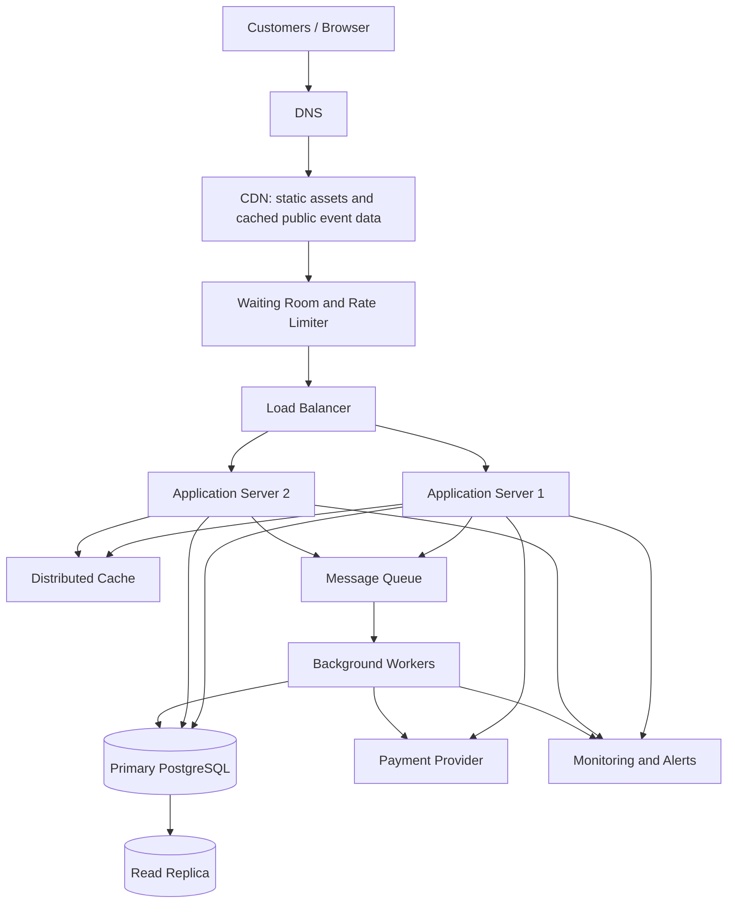

# TicketHub: Ticketing System Design

## 1. Requirements

TicketHub is an online platform where users discover events, choose seats, purchase tickets, and view their orders. It must support 2 million registered users and remain reliable when a popular concert goes on sale.

### Functional requirements

1. Users can register, sign in, and view their profiles.
2. Users can browse, search, and filter concerts and events.
3. Users can view event details, prices, and real-time seat availability.
4. Users can temporarily hold available seats while completing checkout.
5. Users can pay for orders through a payment provider.
6. Users can view their purchased tickets and order history.
7. The system can expire unpaid seat holds and release seats automatically.
8. Administrators can create events, configure seats and prices, and monitor sales.

### Non-functional requirements

- **Speed:** Event pages should load within 2 seconds under normal conditions. Seat availability and checkout responses should normally complete within 500 milliseconds, excluding external payment-provider delays.
- **Correctness:** A seat must never be sold to two different customers. Orders must not be marked paid until payment is confirmed.
- **Fairness:** Customers should be processed through a controlled queue during popular sales. The system should not allow users to bypass the queue by repeatedly refreshing or sending extra requests.
- **Availability:** Browsing should remain available during traffic spikes. If checkout becomes overloaded, the system should reject or queue requests safely rather than oversell tickets.
- **Security:** Users must only access their own orders and tickets. Payment information should be handled by a trusted payment provider.
- **Scalability:** The system should support 2 million registered users and handle a sudden increase in traffic.
- **Data durability:** Confirmed purchases and payment records must not be lost.

## 2. Traffic and Storage Estimates

The estimates below are planning assumptions, not measured production figures. They distinguish normal daily traffic from the first 10 minutes of a popular concert sale.

### Normal traffic

Given:
- Registered users: 2,000,000
- Daily visitors: 50,000
- Pages viewed per visitor: 10
- Tickets sold per day: 5,000

**Page views per day**

50,000 × 10 = 500,000 page views/day

**Average page-view rate**

500,000 ÷ 86,400 ≈ 5.8 page views/second

Assuming traffic peaks at five times the daily average:

5.8 × 5 ≈ 29 page views/second

**Average ticket sales rate**

5,000 ÷ 86,400 ≈ 0.058 tickets/second, or approximately 208 tickets/hour.

### Popular concert sale

Given:
- Customers attempting to buy: 200,000
- Seats available: 20,000
- Sale window: 10 minutes = 600 seconds

**Average purchase-attempt rate**

200,000 ÷ 600 ≈ 333 purchase attempts/second

**Average maximum sales rate needed to sell every seat in 10 minutes**

20,000 ÷ 600 ≈ 33 successful seat sales/second

The system should initially target at least 3,500 incoming purchase-related requests/second as a planning capacity, allowing roughly ten times the average attempt rate. This target should be validated with load testing. It is not a guarantee that every request will succeed immediately.

| Metric | Normal day | Popular sale |
|---|---:|---:|
| Visitors or purchase attempts | 50,000 visitors/day | 200,000 attempts/10 min |
| Page views or attempts per second | 5.8 average page views/s | 333 average purchase attempts/s |
| Available tickets | 5,000 tickets sold/day | 20,000 seats |
| Main concern | Efficient browsing | Queueing, concurrency and overselling |

The average purchase-attempt rate during the sale is about 57 times the normal average page-view rate. Real traffic can arrive in bursts, so TicketHub must use a waiting room, caching, rate limits, and scalable application servers.

Storage will grow with event, order, payment, and ticket records. Exact storage estimates require assumptions about record sizes, retention, and event volume. TicketHub should monitor database growth and archive old operational data according to its retention policy.

## 3. API Design

The API uses REST conventions and JSON. Authenticated endpoints require a valid access token. The examples below show the main endpoints.

| Method and endpoint | Purpose | Success response |
|---|---|---|
| `GET /api/events` | Browse and filter events | `200 OK` |
| `GET /api/events/{eventId}` | View event details | `200 OK` |
| `GET /api/events/{eventId}/seats` | View seat availability and prices | `200 OK` |
| `POST /api/events/{eventId}/holds` | Temporarily hold selected seats | `201 Created` |
| `POST /api/orders/{orderId}/payment` | Start payment for an order | `200 OK` or `202 Accepted` |
| `GET /api/me/tickets` | View the signed-in user's tickets | `200 OK` |
| `GET /api/orders/{orderId}` | View an order's status | `200 OK` |

### Example: Browse events

Request:

`GET /api/events?date=2027-06-15&page=1`

Response:

```json
{
  "events": [
    {
      "id": 42,
      "name": "Summer Live",
      "date": "2027-06-15T18:00:00Z",
      "venue": "City Arena",
      "availableSeats": 1200
    }
  ],
  "page": 1,
  "totalPages": 4
}
```

### Example: Hold seats

Request:

`POST /api/events/42/holds`

```json
{
  "seatIds": [101, 102],
  "idempotencyKey": "checkout-abc-123"
}
```

Successful response:

```json
{
  "orderId": 9001,
  "status": "PENDING",
  "heldSeatIds": [101, 102],
  "expiresAt": "2027-06-01T10:10:00Z"
}
```

If a seat is already held or sold, the API returns `409 Conflict` and does not create a competing hold for that seat.

### Example: Start payment

Request:

`POST /api/orders/9001/payment`

```json
{
  "paymentMethodToken": "provider-token-xyz",
  "idempotencyKey": "payment-9001-attempt-1"
}
```

Response:

```json
{
  "orderId": 9001,
  "status": "PAYMENT_PENDING",
  "message": "Payment is being processed."
}
```

The server verifies the payment using the payment provider's trusted confirmation or webhook before marking the order as paid.

### Error responses

- `400 Bad Request`: invalid input.
- `401 Unauthorized`: the user is not authenticated.
- `403 Forbidden`: the user cannot access the requested resource.
- `404 Not Found`: the event, seat, or order does not exist.
- `409 Conflict`: a seat is no longer available or a hold has expired.
- `429 Too Many Requests`: the client has exceeded its rate limit.
- `500 Internal Server Error`: an unexpected server error occurred.

Error response example:

```json
{
  "error": {
    "code": "SEAT_UNAVAILABLE",
    "message": "One or more selected seats are no longer available."
  }
}
```

## 4. Data Model

TicketHub uses PostgreSQL because seat sales require transactions, relational integrity, and reliable constraints.

The four main tables are `users`, `events`, `seats`, and `orders`. An additional `order_items` table records which seats belong to each order.

### Relationships

- One user can place many orders.
- One event has many seats.
- One order belongs to one user.
- One order can contain many seats through `order_items`.
- Each seat belongs to one event.
- A seat has at most one active hold and can be sold only once.

### SQL schema

```sql
CREATE TABLE users (
    id BIGSERIAL PRIMARY KEY,
    email VARCHAR(255) UNIQUE NOT NULL,
    password_hash TEXT NOT NULL,
    created_at TIMESTAMPTZ NOT NULL DEFAULT NOW()
);

CREATE TABLE events (
    id BIGSERIAL PRIMARY KEY,
    name VARCHAR(200) NOT NULL,
    venue VARCHAR(200) NOT NULL,
    starts_at TIMESTAMPTZ NOT NULL,
    status VARCHAR(20) NOT NULL DEFAULT 'DRAFT'
        CHECK (status IN ('DRAFT', 'ON_SALE', 'SOLD_OUT', 'CANCELLED'))
);

CREATE TABLE seats (
    id BIGSERIAL PRIMARY KEY,
    event_id BIGINT NOT NULL REFERENCES events(id),
    seat_label VARCHAR(30) NOT NULL,
    price NUMERIC(10, 2) NOT NULL CHECK (price >= 0),
    status VARCHAR(20) NOT NULL DEFAULT 'AVAILABLE'
        CHECK (status IN ('AVAILABLE', 'HELD', 'SOLD')),
    held_by_user_id BIGINT REFERENCES users(id),
    hold_expires_at TIMESTAMPTZ,
    sold_order_id BIGINT,
    UNIQUE (event_id, seat_label),
    CHECK (
        (status = 'AVAILABLE'
            AND held_by_user_id IS NULL
            AND hold_expires_at IS NULL
            AND sold_order_id IS NULL)
        OR
        (status = 'HELD'
            AND held_by_user_id IS NOT NULL
            AND hold_expires_at IS NOT NULL
            AND sold_order_id IS NULL)
        OR
        (status = 'SOLD' AND sold_order_id IS NOT NULL)
    )
);

CREATE TABLE orders (
    id BIGSERIAL PRIMARY KEY,
    user_id BIGINT NOT NULL REFERENCES users(id),
    status VARCHAR(20) NOT NULL DEFAULT 'PENDING'
        CHECK (status IN (
            'PENDING', 'PAYMENT_PENDING', 'PAID',
            'EXPIRED', 'CANCELLED', 'FAILED'
        )),
    total_amount NUMERIC(10, 2) NOT NULL CHECK (total_amount >= 0),
    created_at TIMESTAMPTZ NOT NULL DEFAULT NOW()
);

CREATE TABLE order_items (
    order_id BIGINT NOT NULL REFERENCES orders(id),
    seat_id BIGINT NOT NULL REFERENCES seats(id),
    price_at_purchase NUMERIC(10, 2) NOT NULL
        CHECK (price_at_purchase >= 0),
    PRIMARY KEY (order_id, seat_id)
);

ALTER TABLE seats
ADD CONSTRAINT seats_sold_order_fk
FOREIGN KEY (sold_order_id) REFERENCES orders(id);

CREATE INDEX idx_events_sale_date
ON events (starts_at)
WHERE status = 'ON_SALE';

CREATE INDEX idx_seats_event_status
ON seats (event_id, status);

CREATE INDEX idx_orders_user_created
ON orders (user_id, created_at DESC);
```

The seat table stores the current availability state. The order and order-item tables preserve purchase history. A production implementation should also store payment-provider references and use a separate payments table for payment attempts, webhook processing, refunds, and reconciliation.

### Example queries

**1. List events currently on sale**

```sql
SELECT id, name, venue, starts_at
FROM events
WHERE status = 'ON_SALE'
ORDER BY starts_at;
```

**2. View available seats for an event**

```sql
SELECT id, seat_label, price
FROM seats
WHERE event_id = 42
  AND status = 'AVAILABLE'
ORDER BY seat_label;
```

**3. View a user's paid tickets**

```sql
SELECT
    o.id AS order_id,
    e.name AS event_name,
    e.starts_at,
    s.seat_label,
    oi.price_at_purchase
FROM orders o
JOIN order_items oi ON oi.order_id = o.id
JOIN seats s ON s.id = oi.seat_id
JOIN events e ON e.id = s.event_id
WHERE o.user_id = 7
  AND o.status = 'PAID';
```

### Preventing two people from buying the same seat

TicketHub must never rely only on what the browser displays. Two customers may see a seat as available at almost the same time.

When a customer requests a hold, the server begins a database transaction and locks the requested seat rows using `SELECT ... FOR UPDATE`. It then checks that each seat is available, or that its previous hold has expired. If valid, it creates the order and order items and updates the seats to `HELD`, with the user's ID and a short expiry time. The transaction commits only if the entire requested set can be held; otherwise it rolls back.

A simplified example of the locking step is:

```sql
BEGIN;

SELECT id, status, held_by_user_id, hold_expires_at
FROM seats
WHERE id IN (101, 102)
ORDER BY id
FOR UPDATE;

-- Application verifies every seat is available
-- or has an expired hold, then updates all seats.

COMMIT;
```

The application must perform the checks and updates inside the same transaction; the example above deliberately omits the application-specific conditional updates.

Because competing transactions must wait for the same locked rows, only one can successfully hold a particular seat. The application should update a seat conditionally and verify the number of rows changed. If even one selected seat is unavailable, the transaction should roll back the whole hold request.

Before payment is finalized, the server locks the held seats again and verifies that the hold belongs to the customer and has not expired. After trusted payment confirmation, it marks the order `PAID` and the seats `SOLD` in a database transaction. Expired unpaid holds are released safely. Payment requests and webhooks must be idempotent so retries do not create duplicate charges or duplicate orders.

## 5. Architecture

### Architecture diagram



### Component explanations

1. **Browser:** Allows customers to search events, view seats, hold tickets, and pay.
2. **DNS:** Resolves TicketHub's domain to the service's entry point.
3. **CDN:** Serves static files such as JavaScript, CSS, and images close to users. Public event data may be cached briefly, but seat availability and checkout decisions must use authoritative data.
4. **Waiting room and rate limiter:** Controls entry to a popular sale, limits abusive request rates, and reduces overload. Queue position should be assigned fairly, for example through a published randomized or first-come-first-served policy.
5. **Load balancer:** Distributes requests across healthy application servers.
6. **Application servers:** Validate requests, enforce authentication and authorization, manage seat holds, and communicate with the database and payment provider. Multiple servers allow horizontal scaling.
7. **Distributed cache:** Stores frequently requested public event information. Seat availability must not be trusted from a potentially stale cache when confirming a hold or sale.
8. **Primary PostgreSQL database:** The authoritative source for seat status, holds, orders, and transactions. Row locks and constraints protect correctness.
9. **Read replica:** Serves suitable read-only queries, such as event listings and historical order reports. It may lag behind the primary, so seat selection and checkout must use the primary.
10. **Message queue and workers:** Handle tasks such as sending ticket emails, processing payment notifications, expiring holds, and reconciling payment outcomes. Durable messages and retries prevent temporary failures from losing tasks.
11. **Payment provider:** Processes payments securely and reports outcomes through verified callbacks or webhooks.
12. **Monitoring and alerts:** Tracks request latency, error rates, queue length, database lock waits, payment failures, and available seats.

### How the architecture survives a big sale

Before a sale begins, TicketHub can pre-scale its application servers, warm public event caches, and prepare the waiting room. The waiting room admits customers at a controlled rate rather than allowing all 200,000 people to hit checkout simultaneously. The CDN handles static content, while read replicas serve suitable browsing queries.

All seat holds and final sales go through the primary database, where transactions serialize conflicting changes. The system should apply per-user limits, request timeouts, idempotency keys, and backpressure when the database or payment provider approaches capacity. Background work is placed on durable queues instead of delaying every browser response.

If a server fails, the load balancer routes new requests to healthy instances. The database requires backups, replication, health monitoring, and a tested recovery procedure. The primary database and payment provider remain important failure points, so failover, reconciliation, and clear customer messaging are necessary. TicketHub should use load tests to validate its target of approximately 3,500 incoming purchase-related requests per second.

## 6. Trade-offs

### 1. Strong consistency versus speed

Using the primary PostgreSQL database for seat holds and checkout protects correctness but can add latency and create lock contention during a large sale. Serving public event information from a cache or read replica improves speed, but cached availability may be outdated. TicketHub therefore prioritizes correctness for purchasing and uses caching for non-critical browsing data.

### 2. Fairness versus maximum throughput

A waiting room controls overload and gives customers a predictable process, but it adds waiting time and may reduce the number of people admitted per second. Allowing everyone to enter immediately may feel faster but risks overwhelming the database and payment provider. TicketHub prioritizes a controlled and transparent queue over unrestricted access.

### 3. Temporary holds versus seat utilization

Holding a seat for several minutes gives a customer time to pay, but abandoned checkouts temporarily prevent other customers from buying it. Short expirations and automatic release improve availability, while overly short holds may unfairly penalize customers experiencing slow networks or payment delays. TicketHub should choose and publish a reasonable hold duration and handle payment confirmation carefully.

### Conclusion

TicketHub combines scalable browsing infrastructure with a transactional database for all seat allocation and payment-state changes. Its central design rule is that the database—not the browser or cache—decides whether a seat can be held or sold. A controlled waiting room, idempotent payment handling, monitoring, and recovery procedures help the service handle popular sales without double-booking tickets.